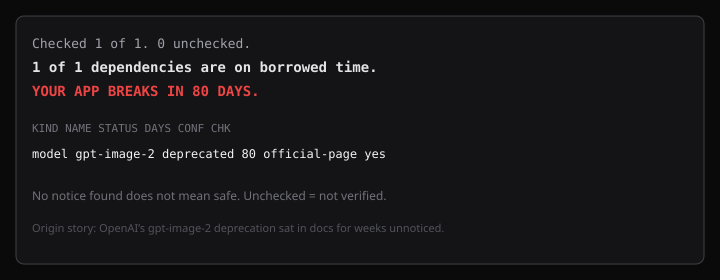

# Sundown

**Expiry-date audit for your whole repo** — models, APIs, packages, runtimes, SaaS.

Origin: OpenAI’s **gpt-image-2** deprecation notice sat in docs for weeks unnoticed. Point Sundown at a repo and it flags what is already on borrowed time — with sources, not guesswork.



Repo: [sid-kiwilab/project-sundown](https://github.com/sid-kiwilab/project-sundown) — full spec in [docs/LIVE.md](docs/LIVE.md).

```bash
git clone https://github.com/sid-kiwilab/project-sundown.git
cd project-sundown
npm install
cp .env.example .env          # optional: OPENROUTER_API_KEY for Tier 2 model notices
npm run build:engine && npm run build:cli
npm run sundown -- .          # private/local path — reads repo-root .env for Tier 2
npm run dev                   # or start.bat (Windows) → http://localhost:3000
npm test
```

**Web:** paste a **public** `https://github.com/owner/repo` URL on the landing page.

**npm:** `npx sundown-cli` is not published yet — use `npm run sundown --` from this repo until release.

Reports show **checked N of M** — “checked” means we queried a named source for that row (no notice on that page still counts). npm/PyPI pins with no deprecation flag show **`healthy`**, not “unverified”. The web UI leads with expiring rows; the CLI prints an **ALARMS** section first. API host rows stay unchecked.

## Deploy on Vercel

1. Import this GitHub repo; **Root Directory** `apps/web`, Framework **Next.js**, **Output Directory empty**, Build Command **empty** (default `next build`). [`apps/web/vercel.json`](apps/web/vercel.json) only overrides install: monorepo `npm install` + `build:engine`.
2. Set **environment variables** (same as `.env.example`):
   - `OPENROUTER_API_KEY` and/or `OPENAI_API_KEY` / `ANTHROPIC_API_KEY` — Tier 2 model notices (**uses LLM credits on every scan that needs Tier 2**).
   - `GITHUB_TOKEN` — recommended for tarball download rate limits.
   - If scans error on missing registry: set `SUNDOWN_MONOREPO_ROOT` to the **repository root** (parent of `registry/`), or `REGISTRY_PATH` to the absolute path of the `registry` folder in the deployment.
3. Do **not** commit `.env` — use the Vercel dashboard only.

**Only** [`apps/web/vercel.json`](apps/web/vercel.json) applies — do not import the monorepo at the repo root without Root Directory `apps/web`.

No credit cap or KV is wired yet; a public scan URL with keys enabled will spend your provider quota.

## Reminders (GitHub Action)

Weekly scans with **no accounts** — Sundown opens or updates **one** alarm issue in the repo.

1. Copy [`.github/workflows/sundown.yml`](.github/workflows/sundown.yml) into your repository (or depend on this repo’s composite action).
2. Grant `issues: write` (see workflow `permissions`).
3. Optional secrets: `OPENROUTER_API_KEY` / `OPENAI_API_KEY` / `ANTHROPIC_API_KEY` for Tier 2 model pages (**burns credits every run**). Without them, npm/PyPI/runtime EOL alarms still run (Tier 1).
4. Locally: `npm run sundown -- . --issue` with `GITHUB_TOKEN` and [GitHub CLI](https://cli.github.com/) installed — upserts the issue labeled **`sundown`** (title `Sundown: dependency expiry alarm`).

```yaml
# Your repo — checkout first, then run Sundown (issues upsert via label: sundown).
permissions:
  contents: read
  issues: write
jobs:
  sundown:
    runs-on: ubuntu-latest
    steps:
      - uses: actions/checkout@v4
      - uses: sid-kiwilab/project-sundown/.github/actions/sundown@main
        with:
          openrouter-api-key: ${{ secrets.OPENROUTER_API_KEY }}
```

---

Stable ops: **[docs/LIVE.md](docs/LIVE.md)**. Session log: **[docs/JOURNAL.md](docs/JOURNAL.md)**.